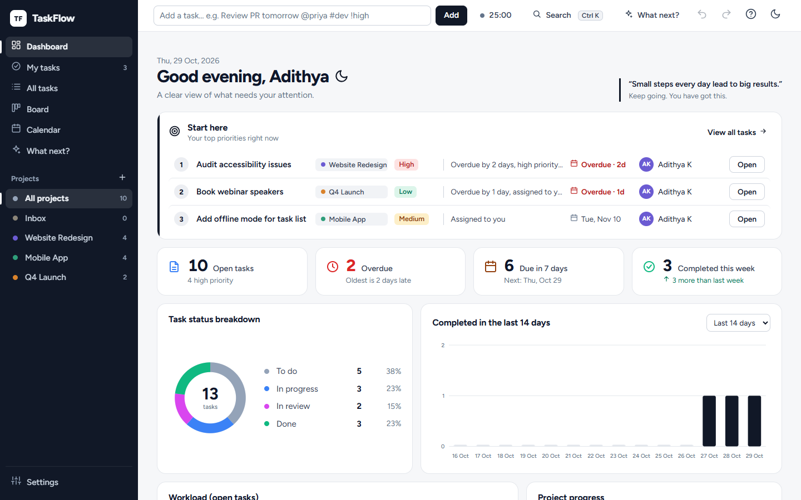
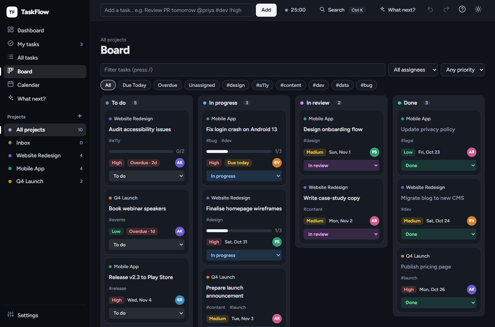
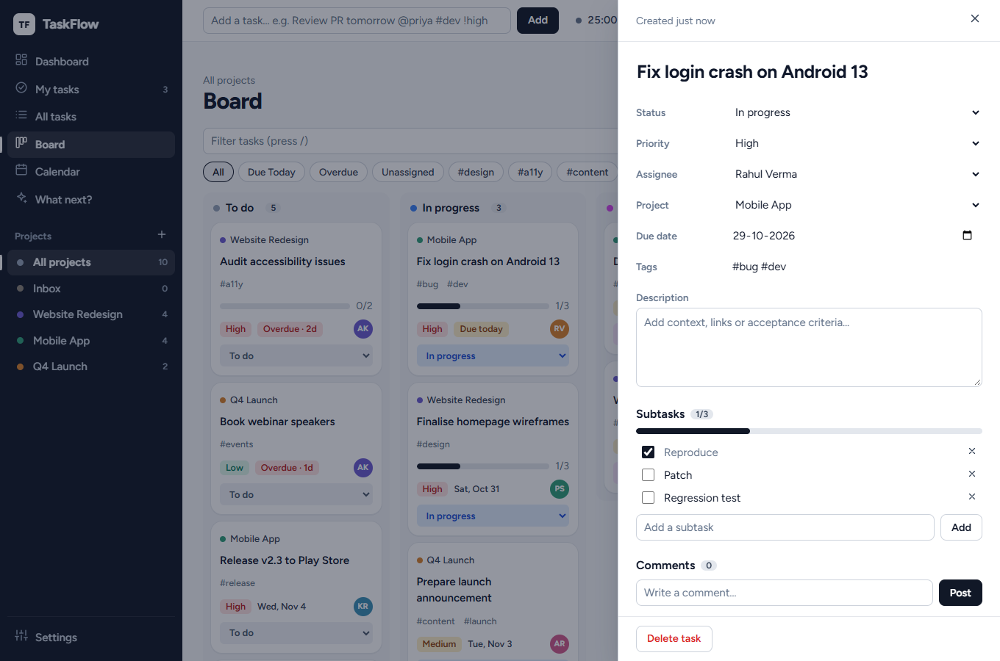
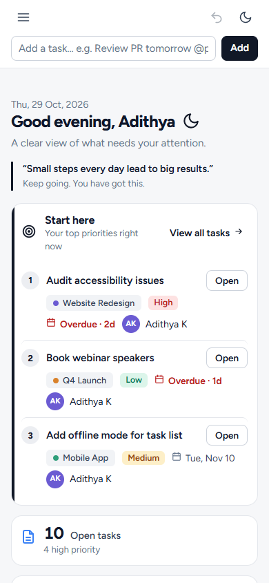

# TaskFlow

A team task manager with accounts, shared workspaces and live sync, built with plain HTML, CSS and JavaScript. No framework and no build step; Supabase provides sign-in, the database and realtime updates.

**Live app:** https://adithyakammara.github.io/taskflow/



| Board, dark mode                          | Task drawer                                 | Mobile                                 |
| ----------------------------------------- | ------------------------------------------- | -------------------------------------- |
|  |  |  |

## Try it

1. Open the live app and **create an account** (name, email, password), then confirm the email.
2. You land in your own workspace. Press **Add sample data** to see a full board, or add a task.
3. Open **Team → Create invite link** and send it to a teammate. When they join, edit a task in one browser and watch it change in the other.

## Features

**Team work**

- Email and password sign-up, sign-in, password reset and log out.
- Workspaces with a switcher in the sidebar; every new account gets one.
- Invite links valid for 7 days. Owners can remove members; members can leave.
- Live sync: a teammate's change shows up in about a second, with no refresh.
- Teammates are the assignees, so `@name`, the assignee filter and **My tasks** use real people.

**Planning**

- **Dashboard:** a "Start here" list of the three tasks to look at first, key numbers, a status donut, a 7/14/30-day completion chart, workload, project progress and upcoming work. All charts are hand-built SVG.
- **Views:** a sortable, filterable list, a drag-and-drop board and a month calendar.
- **Quick add:** type `Review PR tomorrow @priya #dev !high` and the date, assignee, tag and priority are filled in.
- **Task drawer:** status, priority, assignee, due date, tags, description, subtasks, comments and an activity log.

**Speed**

- Undo and redo (50 steps), bulk move, assign and delete, a command palette (`Ctrl K`), a "What next?" ranking and a focus timer.
- Keyboard shortcuts: `N` new task, `/` filter, `F` timer, `?` all shortcuts.

**Data and quality**

- JSON backup and restore, and CSV export guarded against spreadsheet formula injection.
- Keyboard accessible with visible focus, reduced-motion support, light and dark themes, a compact density option and layouts down to phone width.

## How it works

| Layer     | What it does                                                                                                                                         |
| --------- | ---------------------------------------------------------------------------------------------------------------------------------------------------- |
| Front end | ES modules served as static files. One store holds the `{ projects, tasks }` document; views re-render from it.                                      |
| Sync      | After each save, only the rows that changed are written. Teammates' changes arrive over Supabase Realtime. Failed writes retry; reconnects catch up. |
| Database  | Supabase Postgres. Every table has Row Level Security, so people can only read and write workspaces they belong to.                                  |
| Auth      | Supabase Auth with email and password. Joining a workspace is only possible through a valid invite (`accept_invite()`).                              |
| Hosting   | GitHub Pages, deployed by GitHub Actions on every push to `main`.                                                                                    |

A few choices worth knowing:

- All user text is rendered with `textContent` through a small `el()` builder, and everything loaded from the database, storage or an imported file passes through `sanitize` first.
- Diffing, selectors, the quick-add parser and the undo history are pure functions with unit tests.
- When two people edit the same task at the same moment, the last save wins.

## Run it locally

Modules do not load from `file://`, so serve the folder over HTTP:

```bash
npm install
```

```bash
npm start
```

That serves http://localhost:5173 with a tiny zero-dependency server. `npm install` is only needed for tests, linting and formatting.

**Local mode or cloud mode.** `src/backend/env.js` holds the Supabase project URL and public key. With both values set, the app asks people to sign in and syncs through Supabase. Leave them empty and it runs in local mode: no accounts, a demo team, and tasks saved only in that browser.

**Use your own Supabase project.** Fork the repository, create a free Supabase project, run [`supabase/schema.sql`](supabase/schema.sql) in its SQL Editor, set your site address under Authentication, and put your project's URL and publishable key in `env.js`. [docs/SUPABASE.md](docs/SUPABASE.md) walks through each step.

## Project structure

```
index.html
css/              tokens, base, layout, components, views, dialogs, account (+ self-hosted font)
src/
  main.js         wires everything together
  config.js       constants (statuses, priorities, team, limits)
  backend/        Supabase settings, client, accounts, workspaces and live sync
  model/          pure logic: sanitising, quick-add parser, selectors, row diffing
  store/          state, undo/redo history, storage, actions
  views/          dashboard, list, board, calendar, charts, app frame
  ui/             sign-in and team, drawer, dialogs, palette, shortcuts, theme, toast
  features/       sample data, import and export
  utils/          dates, text, DOM builder, CSV
supabase/         schema.sql: tables, Row Level Security, triggers, invite function
tests/            unit tests for the pure logic
scripts/serve.mjs static dev server
```

## Scripts

| Command                           | What it does                                 |
| --------------------------------- | -------------------------------------------- |
| `npm start`                       | Serve the app locally                        |
| `npm test`                        | Run unit tests (Node's built-in test runner) |
| `npm run lint`                    | ESLint                                       |
| `npm run format` / `format:check` | Prettier                                     |
| `npm run check`                   | Lint, format check and tests together        |

GitHub Actions runs `check` on every push and pull request (`.github/workflows/ci.yml`) and deploys to GitHub Pages on every push to `main` (`.github/workflows/pages.yml`).

## Roadmap

- [x] Dashboard, list, board and calendar views with tests and CI
- [x] Accounts, workspaces, invite links and live team sync
- [ ] Roles beyond owner and member (for example, view-only guests)
- [ ] Rename and delete workspaces
- [ ] Email notifications when a task is assigned to you
- [ ] Audit log and reports

## Credits

Built by [Adithya Kammara](https://github.com/AdithyaKammara) · [LinkedIn](https://linkedin.com/in/adithyakammara)

Font: [Figtree](https://github.com/erikdkennedy/figtree), under the SIL Open Font License (copy in `css/fonts/`). Licensed under MIT.
